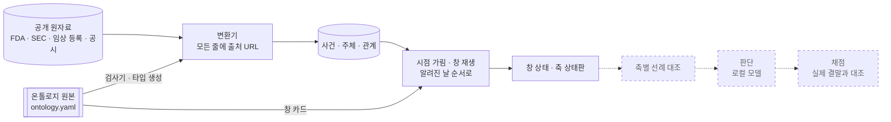

# NESTOR

**선례 기반 투자 리스크 분석 시스템** · Precedent-based analysis of investment events

> [!NOTE]
> **진행 중인 프로젝트다.** 개발은 비공개 저장소에서 계속하고 있고, 그 가운데 **설계가 확정된 부분부터 이 저장소(Nestor)로 옮기고 있다.** 아직 옮기지 않은 부분과 개발 중인 부분은 [옮기는 현황](#옮기는-현황)에 적어 두었다. 마지막 갱신: 2026-11-17

투자 사건 한 건을 과거 선례에 견줘 분석한다. 다섯 축(상황 · 주체 · 기술 · 구조 · 형태)에서 같은 위험을 지나간 과거 사건을 찾아 대조하고, 눈에 띄는 호재에 가려진 **결말을 가를 축**을 짚는 것이 목표다.

| | |
|---|---|
| 기간 | 2026년 9월 ~ 진행 중 (대학 캡스톤, 2인 팀) |
| 맡은 일 | 팀장. 문제 정의 · 온톨로지와 축 설계 · 검증 기준 · 전체 설계 결정과 검수 |
| 기술 | Python · pydantic · LinkML · FastAPI · React/TypeScript · MLX(Qwen3, QLoRA) |
| 규모(개발 저장소) | 사건 약 12.2만 · 주체 약 3.3만 · 관계 약 2.4만 줄, 원자료 변환기 19개, 시험 함수 약 2,400개 |

---

## 옮기는 현황

| 부분 | 내용 | 상태 |
|---|---|---|
| 소개 | 이 문서 | 옮김 |
| 문제 정의 | 왜 선례인가, 왜 바이오로 시작했나 | 옮기는 중 |
| 온톨로지 · 시점 | 원본 하나 · 층 넷 · 사건 · 주체 · 관계 · 날짜 넷 | 옮기는 중 |
| 사건 진행 층 | 촉매 창과 창 카드, HLB 재생 예 | 옮기는 중 |
| 검증 설계 | 결과 전 등록 · 기준선 · 형식과 판단의 분리 | 옮기는 중 |
| 온톨로지 원본 | `ontology.yaml`과 생성된 관계 그림 | 옮기는 중 |
| 선례 대조 · 판단 | 같은 위험을 지나간 선례를 찾고 읽는 법 | **개발 중** — 정의를 다시 세우고 있다. 확정되면 옮긴다 |
| 학습 | 로컬 모델 판단자 | **개발 중** |
| 화면 | 다섯 축 종합 · 근거 원문 | **다시 설계 중** |

이 저장소에는 원자료와 그 파생 자료, 학습 줄, 모델 가중치를 넣지 않는다. 출처 약관과 용량 때문이다. 사례를 따라갈 수 있는 표본만 둔다.

---

## 1. 문제

신약 승인은 효능 · 안전성 · 제조 같은 여러 축이 함께 정한다. 그런데 사람도 범용 모델도 눈에 띄는 축에 끌린다.

출발점은 실제로 틀린 판단 하나다. HLB의 간암 병용 요법은 2025년 11월 임상 3상 최종 분석에서 효능이 확인됐고, 나는 재제출이 승인될 것으로 봤다. 2026년 7월 FDA는 세 번째 보완 요구 서한을 냈고, 사유는 효능이 아니라 중국 협력사(항서제약) 공장의 제조였다. 앞선 두 번의 서한도 제조였다. 선례가 있었는데 읽지 않은 것이다.

| | 판단 |
|---|---|
| 흔한 실수 | 효능이 확인됐다 → 그러니 승인 |
| 바라는 분석 | 효능이 확인됐다 → 효능 축은 지운다 → 남은 위험은 제조 → 같은 위험을 지나간 선례는 어떻게 갈렸나 → 그것을 가를 사실이 지금 확인됐나 |

전 업종으로 넓히기에 앞서, 조건 하나가 결말과 주가를 크게 바꾸고 결말 기록(서한 · 승인 · 실사)이 공개되는 바이오를 첫 시험 업종으로 골랐다.

---

## 2. 설계 한눈에

실선은 설계가 확정된 부분, 점선은 개발 중인 부분이다.



---

## 3. 확정된 설계

### 3.1 다섯 축

사건을 다섯 면으로 나누어 면마다 따로 선례를 찾는다. 한 면이 좋다는 사실이 다른 면의 위험을 덮지 않게 하기 위해서다.

| 축 | 무엇을 보나 |
|---|---|
| 상황 | 규제 기조 · 심사 경로 · 짝 약에 기대는 신청인가 |
| 주체 | 누가 만들고 누가 쥐나 — 회사 · 제조소 · 파트너와 그들의 이력 |
| 기술 | 효능 기준선 · 경쟁 지형 · 시험 설계 |
| 구조 | 재무 여력(버틸 현금 · 조달)과 기업 구조(지배 · 계열) |
| 형태 | 시장이 어떻게 반응했나 — 모든 축 사건의 공통 결말로 본다 |

### 3.2 온톨로지

- **원본 하나:** LinkML YAML 한 파일에서 검사기 · 타입 · 그림을 생성한다. 정의가 코드와 문서에 따로 흩어지지 않게 하기 위해서다.
- **층 넷:** 고치는 이유에 따라 나눈다.

| 층 | 하는 일 |
|---|---|
| 기록층 | 사건 · 주체(회사 · 약과 신청 · 제조소 · 기관) · 저장 관계(지분 · 계약 · 공급 · 결말)를 저장한다 |
| 키네틱층 | 사건을 재생해 창 상태를 계산한다. 저장하지 않는다 |
| 판단층 | 축 · 질문 종류 · 선례 거리처럼 판단이 쓰는 값을 둔다 |
| 사람 행동층 | 어휘 승격 · 판정 · 등급처럼 사람이 검수해 정하는 값을 둔다 |

- **출처:** 모든 줄에 출처 · 원문 URL · 채집 시각을 단다. 하나라도 비면 저장하지 않는다.

### 3.3 시점 — 당사자의 눈

분석 시점 뒤에 알려진 정보가 입력에 섞이면 분석은 그럴듯해 보여도 쓸모가 없다. 그래서 기록마다 날짜를 넷으로 둔다.

| 칸 | 뜻 |
|---|---|
| `date` | 사건이 일어난 날 |
| `source_date` | 원문 문서에 적힌 날, 당사자가 원문을 받은 날 |
| `public_date` | 원문이 공개된 날 (규제기관이 뒤에 일괄 공개한 서한 등) |
| `fetched_at` | 채집한 시각 |

자기 사건은 원문 날짜부터, 남의 사건은 공개일부터 보인다. 이 구분이 필요한 이유는 숫자로 드러난다. FDA 보완 요구 서한에 막힌 신청 차수 349건 가운데 301건은 서한 본문이 180일 넘게 늦게 공개됐다. 일어난 날 하나로만 가리면 그 시점에는 아무도 볼 수 없던 서한 본문이 과거 분석에 섞인다.

### 3.4 사건 진행 층 — 촉매 창

판단 단위는 **촉매 창**이다. 투자 사건 한 건은 창 하나이고, 창은 시작 기록 → 기관이 쥔 시계 → 결말 기록으로 이어지는 한 구간이다.

- **창 카드:** 창 종류마다 카드 한 장이 상태 · 전이 · 시계 · 축 효과 · 연쇄를 담는다.
- **카드 여섯 장:** FDA 신청 · 서한 뒤 재제출까지 · 제조소 실사 · 자금 조달 · 조달 뒤 버팀 · 시험 결과.
- **나눠 맡김:** 규칙은 온톨로지에, 실행은 재생기에, 무게는 엔진과 모델에 둔다. 카드에는 숫자 무게가 없다.
- **재생기:** 관점 하나 · 시점 하나에서 사건을 알려진 날 순서로 돌려 창 상태 · 역할 · 판단 시점 · 경고를 낸다.

예를 들어 HLB의 리보세라닙 신청은 2024년 5월 첫 서한 → 2025년 3월 두 번째 서한 → 2026년 7월 세 번째 서한으로 이어진다. 이 흐름은 신청 창과 재제출 창이 번갈아 열리고 닫히는 경로로 재생된다.

### 3.5 검증 원칙

분석이 그럴듯해 보이는 것과 맞는 것은 다르다. 그래서 재는 법을 먼저 정했다.

| 원칙 | 내용 |
|---|---|
| 결말이 정답 | 정답은 사람 의견이 아니라 실제 결말 기록(서한 · 승인)과 그 결정 축에서 온다 |
| 결과 전 등록 | 지표와 이기는 조건을 측정 전에 적고, 결과를 본 뒤 고치지 않는다 |
| 형식 · 판단 분리 | 글이 형식에 맞는가와 판단이 맞았는가를 따로 잰다 |
| 기준선과 나란히 | "늘 제조"처럼 아무것도 안 보고 내는 답을 같은 표에 둔다 |
| 결말 전 등록 | 아직 결말이 나지 않은 사건에 분석을 미리 등록해 두고, 결말이 나면 채점한다 |

---

## 4. 진행 중인 것

**선례 대조 · 판단.** 지금까지 만든 선례 대조 방식은 기준선 "늘 제조"를 넘지 못했다. 보완 요구 서한에 막힌 신청 15건에서 엄격한 대조 규칙은 4건을 짚었고, "늘 제조"는 9건을 짚었다(대신 승인된 7건에도 모두 경고를 냈다). 한 사례에서는 결말이 반대인 두 신청이 기록된 열두 칸에서 모두 같았다. 그래서 "닮은 사건을 찾으면 결말이 보인다"는 처음 가정을 버리고, 선례를 **같은 위험 경로를 지나간 과거 사건**으로 다시 정의하는 중이다. 정의가 확정되면 이 저장소로 옮긴다.

**학습.** 맥북 한 대에서 서빙과 QLoRA 학습까지 돌린다. 분석 경로에서는 외부 모델 API를 부르지 않는다. 학습 정답은 실제 결말과 그 결정 축으로 정해 두었다. 학습은 판단 방식이 확정된 뒤에 한다.

**화면.** 다섯 축 종합 화면과 근거 원문 화면을 다시 설계하고 있다.

---

## 5. 만든 방식

설계 판단과 검수는 직접 하고, 구현은 Claude Code에 맡겼다. 역할별 에이전트에 일을 나누고, 훅으로 경로 소유 · 문서 형식 · 시험 통과를 강제했다. 되돌리기 비싼 결정은 근거와 함께 기록으로 남겼다(결정 106건). 그 가운데 설계를 바꾼 결정은 옮기는 대로 따로 정리한다.

---

## 6. 저장소 구성 (옮기는 대로 채운다)

```
README.md
docs/       문제 · 온톨로지와 시점 · 사건 진행 층 · 검증 설계
schema/     온톨로지 원본과 생성된 그림
examples/   HLB 사건 줄 표본(출처 URL 포함)과 창 재생 결과
assets/     그림
```

라이선스는 옮기기를 마칠 때 붙인다.

---

투자 조언이 아니다. 연구용 시제품이다.
